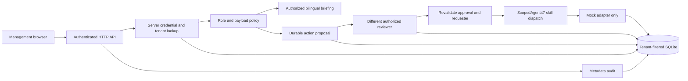

# Architecture and security boundary

## Identity and data

Every request resolves a random 384-bit bearer credential to an active user,
tenant and role in the database. Only SHA-256 token digests are stored. Roles
never come from request headers, prompts, payloads or model output. Expired or
revoked tokens fail closed. There are no default secrets, cookies or public user
provisioning endpoints. One physical SQLite database is shared; all resource
lookups/mutations use tenant predicates and composite keys. This is application
isolation, not separate-database or PostgreSQL RLS isolation.

The local operator is a trusted superuser. A compromised application process or
database administrator can read/change every tenant. For stronger deployment
boundaries use separate instances/databases or migrate to PostgreSQL RLS with
tenant context and explicit cross-tenant regression tests.

## Read roles

| View | Roles |
| --- | --- |
| Calendar, tasks | All; staff sees only own rows |
| Meetings, staffing | admin, executive, operations |
| Enrollment | admin, executive, admissions |
| Sales | admin, executive, admissions, finance |
| Expenses | admin, executive, finance |
| Audit metadata | admin, executive |

## Write and approval policy

| Skill | Proposer | Separate reviewer |
| --- | --- | --- |
| task.create | admin, executive, operations, staff | None; internal only, staff can assign only self |
| meeting.record | admin, executive, operations | None; internal notes and linked tasks only |
| calendar.create | admin, executive, operations | admin or executive |
| outbound.send | admin, executive, operations, admissions | admin or executive |
| expense.pay | admin, executive, finance | admin, executive or finance |
| record.delete | admin | another admin |
| retention.set | admin | another admin |

Actions bind the tenant, requester, operation, payload digest, idempotency key,
expiry and reviewer. Content cannot be replaced through the API. Reviewers see
only their own requests or operations they may approve. Execution is requester
only; it rechecks current requester/reviewer permissions and integrity. Rejection
is terminal. `BEGIN IMMEDIATE` serializes local effects and state transitions;
replays of completed actions return the original result. A failed transaction
rolls back effects. Failed authorized requests create metadata-only denial events
after rolling back the route savepoint.

No live side effect is possible. Real remote execution would require an outbox,
leased worker, provider idempotency and reconciliation of uncertain outcomes.
Do not simply add network calls inside the SQLite transaction.

## Untrusted text and secrets

Meeting notes, records and assistant input are data. No shell, dynamic import,
eval, model tool loop or arbitrary URL fetching is reachable. Browser rendering
uses `textContent`, never user-provided HTML. Static files are allowlisted; CSP
blocks inline scripts and external resources. Credentials remain in memory and
authorization headers, never browser persistent storage or application logs.
Requests have body limits, socket timeouts and a bounded IP rate limiter.

API keys are not needed, created or written by this build. A secure OpenAI setup
was opened earlier, but no confirmed key target/destination was returned in this
conversation. No live OpenAI integration is claimed. If enabled later, keep keys
in a server secret manager, scope them per environment, never send them to the
browser, and require the same deterministic policy boundary for all proposed
model actions. Treat provider responses and retrieved documents as untrusted.

## Limits

Local pilot authentication is not SSO/MFA. HTTP server is development-oriented,
loopback only; browser locks after 15 minutes without interaction or on a 401 response. Audit is durable metadata,
not tamper-proof against database administrators. Source records and approved
payloads are plaintext in the database. Use synthetic data until deployment
controls and approved systems/data scopes are in place. Read lists are capped
at 200 rows; dashboard counts describe that view, not institution-wide totals.
